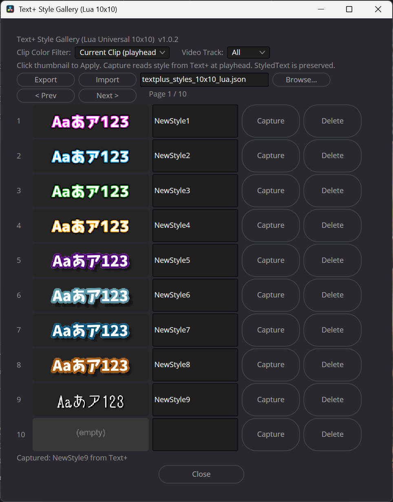

# Text+ Style Gallery for DaVinci Resolve



Text+ styles can be captured, previewed as thumbnails, and applied with a single click.

A lightweight **native Lua style gallery for Text+** in DaVinci Resolve / Fusion.

Save frequently used Text+ looks, preview them as thumbnails, and apply them to other Text+ clips without replacing the actual text content.

**Version:** 1.1.0  
**Release date:** 2026-09-13

## Features

- 100 style slots: **10 pages × 10 slots**
- Capture a style from the Text+ clip at the playhead
- Apply a saved style by clicking its thumbnail
- Preserves `StyledText`, so the destination clip's actual text is not replaced
- Apply to the current clip or filter targets by video track / clip color
- Multiple Text+ **Shading Elements** supported, including fills, outlines, shadows and borders
- **Gradient Fill** support, including multiple color stops
- Gradient Mapping settings including **Angle, Size, Aspect, and Mapping Level**
- **Image Shading** support using external image files
- Image Shading settings including **Mapping Angle, Size, Aspect, Mapping Level, Image Sampling, and Image Edge**
- Character-level and whole-text Border Fill / Border Outline support
- SVG thumbnail previews generated directly in Lua
- No Python or Pillow dependency
- Import / Export of the style library as JSON
- Per-user writable data folder
- Fast Prev / Next paging without rebuilding the window
- Mixed Latin/Japanese preview text: `Aaあア123`

## Installation

Download `TextPlus_Style_Gallery.lua` from the latest GitHub Release.

### Windows

Copy `TextPlus_Style_Gallery.lua` to the following folder:

```text
%APPDATA%\Blackmagic Design\DaVinci Resolve\Support\Fusion\Scripts\Utility\
```

You can paste the path above directly into the Windows File Explorer address bar.

If the `Utility` folder does not exist, create it.

### macOS

Copy `TextPlus_Style_Gallery.lua` to the following folder:

```text
~/Library/Application Support/Blackmagic Design/DaVinci Resolve/Fusion/Scripts/Utility/
```

If the `Utility` folder does not exist, create it.

### After installation

1. Restart DaVinci Resolve if it is already running.
2. Open DaVinci Resolve and load your project.
3. Make sure the project contains a **Text+** title.
4. Open **Workspace > Scripts** from the DaVinci Resolve menu.
5. Select **TextPlus_Style_Gallery**.

The **Text+ Style Gallery** window should appear.

> **Note:** The exact script location or menu structure may vary depending on your DaVinci Resolve version and installation.

## Basic usage

1. Put the playhead over a Text+ clip whose style you want to save.
2. Open **Text+ Style Gallery**.
3. Choose an empty slot and click **Capture**.
4. Enter or edit the style name if desired.
5. Move the playhead to another Text+ clip.
6. Click the saved thumbnail to apply the style.
7. Use **Prev / Next** to move through the 10 pages.

The script preserves the destination Text+ clip's `StyledText` while applying the saved style.

## Target filters

The controls at the top of the gallery can limit operations by **Clip Color** and **Video Track**. Use these carefully when applying a style to more than the current clip.

## Style data

The gallery stores its working library in a per-user writable data directory. The default Lua library filename is:

```text
textplus_styles_10x10_lua.json
```

Use **Export** before moving machines or making major changes. Use **Import** to load a previously exported library.

## Gradient support

Text+ Gradient Shading can be captured and reapplied, including:

- Two-color gradients
- Multi-stop gradients
- Mapping Angle
- Mapping Size
- Mapping Aspect
- Mapping Level (Character / Text)

Gradient data is preserved using Fusion's native settings representation.

Gradient thumbnails are intended for style identification rather than pixel-accurate reproduction. They use a representative color together with a small gradient indicator bar.

## Image Shading

Text+ Image Shading can be captured and reapplied, including:

- External image file reference
- Mapping Angle
- Mapping Size
- Mapping Aspect
- Mapping Level
- Image Sampling
- Image Edge

### Important: external image files

Image Shading stores a reference to the **original external image file path**. The image itself is not embedded or copied into the gallery JSON.

If the source image is moved, renamed, deleted, or unavailable on another computer, the style settings can still be applied, but the referenced image cannot be displayed.

Therefore, exporting the JSON alone does **not** make Image Shading assets fully portable between computers.

## Thumbnail preview

Thumbnail previews use:

```text
Aaあア123
```

This intentionally combines Latin letters, Japanese hiragana/katakana and numbers so both Latin and Japanese font styles are easier to distinguish. On systems without Japanese glyph support, those glyphs may be rendered with a fallback font; this does not affect style application.

Thumbnail rendering is an approximation of Resolve's Text+ renderer. Gradient and Image Shading previews are simplified and are intended for identifying styles rather than reproducing Resolve's final render exactly.

## Notes and limitations

- This is a native Lua script intended for DaVinci Resolve / Fusion's scripting environment.
- The gallery focuses on reusable **static Text+ appearance styles**.
- Animation, keyframes, Follower, expressions, and Character Level Styling are outside the scope of the gallery.
- The destination clip's `StyledText` is preserved when applying a style.
- Protected layout and position values are preserved when applying a style.
- Image Shading depends on the referenced external image file remaining available at its stored path.
- SVG thumbnail display depends on the Qt image support bundled with DaVinci Resolve.
- Keep a backup/export of important style libraries.

## License

Released under the **MIT License**. See `LICENSE`.

## Release

The latest release is **v1.1.0**.

v1.1.0 adds Gradient and Image Shading support, improves Border thumbnail representation, and improves reliable switching between Gradient and Solid Shading styles.

See `CHANGELOG.md` and `RELEASE_NOTES_v1.1.0.md` for details.
